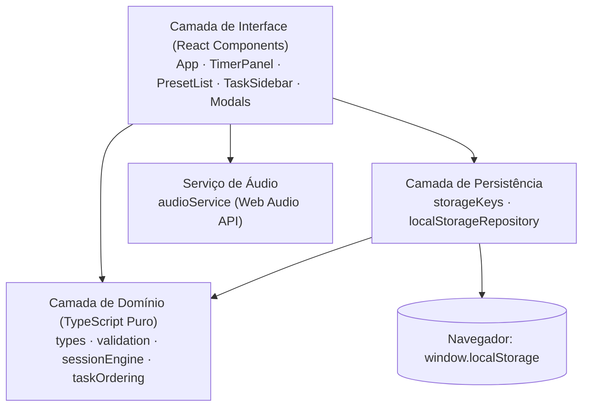

# FocoEstudo — Aplicação Web de Gestão de Foco (Pomodoro)

Aplicação web *single-user* para gestão de ciclos de foco baseados na técnica **Pomodoro** e organização de tarefas de estudo, desenvolvida em **TypeScript** e **React**, com persistência integral em **Local Storage**, interface 100% em português, layout responsivo e retomada automática de sessão por *timestamps* absolutos.

---

## Sumário

1. [Visão Geral e Objetivo](#1-visão-geral-e-objetivo)
2. [Funcionalidades Principais](#2-funcionalidades-principais)
3. [Tecnologias Utilizadas](#3-tecnologias-utilizadas)
4. [Decisões Técnicas Adotadas](#4-decisões-técnicas-adotadas)
5. [Arquitetura do Sistema](#5-arquitetura-do-sistema)
6. [Modelo Conceitual de Dados e Persistência](#6-modelo-conceitual-de-dados-e-persistência)
7. [Regras de Negócio Implementadas](#7-regras-de-negócio-implementadas)
8. [Validações de Entrada](#8-validações-de-entrada)
9. [Casos de Uso Atendidos](#9-casos-de-uso-atendidos)
10. [Áudio e Som Ambiente](#10-áudio-e-som-ambiente)
11. [Como Executar Localmente](#11-como-executar-localmente)
12. [Testes Automatizados e Build](#12-testes-automatizados-e-build)

---

## 1. Visão Geral e Objetivo

O **FocoEstudo** foi projetado para estudantes que desejam aprimorar a eficiência de suas sessões de estudo utilizando ciclos estruturados de foco e descanso, sem depender de servidores externos, cadastros ou conexão contínua com a internet.

Toda a execução ocorre diretamente no navegador do usuário, preservando os temporizadores personalizados, as tarefas registradas e o andamento exato da sessão ativa mesmo após o fechamento ou recarregamento do navegador.

---

## 2. Funcionalidades Principais

- **Gestão de Temporizadores Personalizados (*Presets*)**:
  - Criação, listagem, edição e exclusão (com confirmação explícita) de configurações reutilizáveis contendo nome, tempo de foco, pausa curta, ciclos até a pausa longa e tempo de pausa longa.
  - Bloqueio automático de edição e exclusão enquanto o temporizador estiver vinculado a uma sessão ativa em andamento ou pausada.
- **Execução Completa de Sessão de Foco**:
  - Alternância guiada entre fases de **Foco**, **Pausa Curta** e **Pausa Longa**, com anel circular de progresso em SVG, relógio regressivo `MM:SS` e indicadores visuais de ciclos.
  - Controles de **Iniciar**, **Pausar**, **Retomar**, **Pular Fase**, **Reiniciar Ciclos** e **Encerrar Sessão**.
  - Troca rápida de temporizador com encerramento automático da sessão anterior e captura de *snapshot* dos parâmetros.
- **Persistência e Retomada Automática por *Timestamps***:
  - Recálculo exato ao reabrir o navegador ou retornar de abas suspensas em segundo plano: sessões pausadas retornam pausadas; sessões em andamento avançam automaticamente pelas fases vencidas até a fase vigente ou até a conclusão da sessão.
  - Opção dedicada para **Descartar sessão retomada** com confirmação do usuário.
  - Verificação de integridade dos dados no `localStorage`, oferecendo descarte seguro em caso de estado corrompido.
- **Alerta Sonoro e Som Ambiente Opcional**:
  - Alerta sonoro melódico sintetizado via **Web Audio API** ao término de cada fase, com desbloqueio automático do contexto de áudio no início da sessão.
  - Gerador acústico opcional de **Som Ambiente** em estéreo (*Chuva na Janela*, *Ondas do Mar*, *Harmonia Zen* e *Ruído Marrom*) com controle de volume integrado e execução 100% local.
- **Painel Lateral de Tarefas de Estudo**:
  - Cadastro, edição, atualização rápida de estado e exclusão (com confirmação obrigatória) de tarefas totalmente desacopladas do temporizador.
  - Estados suportados: **Backlog**, **A fazer**, **Em execução**, **Concluída** e **Cancelada**.
  - Prioridades suportadas: **Alta**, **Média** e **Baixa**.
  - Ordenação automática fixa por prioridade decrescente e estado de execução.
  - Layout responsivo: exibido à direita do temporizador em telas *desktop* e reorganizado abaixo do temporizador em telas menores/dispositivos móveis.

---

## 3. Tecnologias Utilizadas

| Camada / Ferramenta | Tecnologia |
| :--- | :--- |
| Linguagem | **TypeScript 5** (tipagem estrita) |
| Biblioteca de Interface | **React 18** |
| Empacotador / Servidor Dev | **Vite 6** |
| Estilização | **CSS3** customizado com variáveis dinâmicas por fase e CSS Grid/Flexbox responsivo |
| Ícones | **Lucide React** |
| Síntese Sonora | **Web Audio API** nativa do navegador |
| Persistência | **Web Storage API (`localStorage`)** |
| Testes Automatizados | **Vitest** + **JSDOM** |

---

## 4. Decisões Técnicas Adotadas

Esta seção documenta as principais escolhas arquiteturais e técnicas da equipe e as respectivas justificativas frente aos requisitos do projeto:

1. **Vite + React 18 + TypeScript em modo estrito (`strict: true`)**:
   - Atende integralmente à restrição `RT-01`, garantindo inicialização rápida, *bundle* enxuto e verificação estática rigorosa de tipos nas entidades (`TemporizadorPersonalizado`, `SessaoAtiva`, `Tarefa`) e transições de fase, reduzindo falhas em tempo de execução.
2. **Separação explícita entre Domínio, Persistência, Serviços e Interface (`RNF-09`)**:
   - Toda a lógica crítica (`sessionEngine.ts`, `validation.ts`, `taskOrdering.ts`) foi isolada em funções puras de TypeScript, desacopladas de React e do DOM. Isso melhora a manutenibilidade e permite testes determinísticos (injetando o instante `agoraMs` diretamente nas funções, sem depender de esperas reais de relógio).
3. **Recálculo temporal baseado em *timestamps* absolutos (`inicioFaseEm` / `fimFasePrevistoEm`)**:
   - Navegadores modernos suspendem ou limitam `setInterval` em abas inativas (`R-02`) e interrompem a execução ao fechar o navegador. Em vez de decrementar contadores em memória, o motor compara `Date.now()` com *timestamps* absolutos e sincroniza o estado nos eventos `focus` e `visibilitychange`, garantindo precisão temporal (`RNF-03`) e retomada automática consistente (`UC10`, `RN-06` a `RN-08`).
4. ***Snapshot* imutável na sessão e distinção entre etapa do ciclo (`cicloAtual`) e ciclos concluídos (`ciclosConcluidos`)**:
   - Ao iniciar a sessão, uma cópia dos parâmetros do *preset* (`snapshotPreset`) é congelada na sessão ativa, assegurando imunidade a edições futuras (`RN-05`). Além disso, separar `cicloAtual` de `ciclosConcluidos` permite que o controle **Pular Fase** (`UC06`) avance por todas as fases previstas até a pausa longa e o encerramento sem contabilizar fases puladas como ciclos concluídos (`RN-03`).
5. **Persistência defensiva sobre `localStorage` com validação na leitura (`R-03`, `RNF-06`)**:
   - Para evitar que gravações parciais ou alterações manuais no armazenamento do navegador quebrem a aplicação, `localStorageRepository.ts` valida estruturalmente todos os dados ao carregar, encapsula escritas em blocos `try/catch` (reportando falhas de cota ou permissão na interface) e oferece descarte seguro caso a sessão persistida esteja corrompida.
6. **CSS3 próprio com *Custom Properties* (variáveis CSS) em vez de biblioteca externa**:
   - O documento concede liberdade de estilização; optar por CSS3 nativo com Grid/Flexbox e variáveis dinâmicas por fase (`Foco`, `Pausa Curta`, `Pausa Longa` e `Concluída`) evita sobrecarga de dependências, facilita o layout responsivo (`RF-18`, `RNF-05`) e oferece controle direto de contraste e foco visível para acessibilidade por teclado (`RNF-07`).
7. **Alertas sonoros e som ambiente sintetizados via Web Audio API**:
   - Sintetizar os alertas e o som ambiente opcional (*Chuva na Janela*, *Ondas do Mar*, *Harmonia Zen* e *Ruído Marrom*) diretamente no navegador elimina dependência de arquivos de mídia externos, funciona 100% offline e mitiga políticas de *autoplay* (`R-01`, `RNF-10`) ao inicializar o `AudioContext` na interação explícita do usuário com o botão **Iniciar**.
8. **Estado nativo com React Hooks e testes automatizados com Vitest + JSDOM**:
   - Como se trata de uma aplicação *single-user* sem *backend* (`RT-03`), os hooks nativos do React (`useState`, `useMemo`, `useCallback`, `useEffect`) entregam simplicidade e baixa latência de interface (`RNF-01`), dispensando gerenciadores globais pesados. O **Vitest** foi escolhido pela integração nativa com Vite/TypeScript, cobrindo testes unitários de regras de negócio e testes de integração dos fluxos da interface.

---

## 5. Arquitetura do Sistema

O projeto adota separação clara de responsabilidades entre **Domínio**, **Persistência**, **Serviços** e **Interface** (`RNF-09`):



### Estrutura de Diretórios

```text
├── index.html                        # Página raiz em pt-BR
├── package.json                      # Dependências e scripts npm
├── tsconfig.json                     # Configuração TypeScript estrita
├── vite.config.ts                    # Configuração do Vite e Vitest
├── Documento de Requisitos...pdf     # Especificação oficial de requisitos (SRS)
└── src/
    ├── main.tsx                      # Ponto de entrada React
    ├── App.tsx                       # Orquestração de estado global e fluxos
    ├── styles.css                    # Estilos responsivos e temas visuais de fase
    ├── domain/
    │   ├── types.ts                  # Entidades e tipos do modelo conceitual
    │   ├── validation.ts             # Regras VR-01..VR-08 e validação de integridade (R-03)
    │   ├── sessionEngine.ts          # Motor Pomodoro baseado em timestamps absolutos
    │   └── taskOrdering.ts           # Ordenação fixa RN-10 e rótulos de estado/prioridade
    ├── persistence/
    │   ├── storageKeys.ts            # Chaves oficiais do Local Storage
    │   └── localStorageRepository.ts # Leitura/gravação segura com captura de erros
    ├── services/
    │   └── audioService.ts           # Alertas de fim de fase e som ambiente sintetizado
    ├── components/
    │   ├── TimerPanel.tsx            # Relógio circular, fases, ciclos, controles e som ambiente
    │   ├── PresetList.tsx            # Listagem, seleção, troca e bloqueio RN-01 de presets
    │   ├── PresetFormModal.tsx       # Modal de criação/edição de preset com erros por campo
    │   ├── TaskSidebar.tsx           # Painel lateral direito responsivo de tarefas
    │   ├── TaskFormModal.tsx         # Modal de criação/edição de tarefa (padrão RN-12)
    │   └── ConfirmDialog.tsx         # Diálogo acessível para confirmações explícitas (RN-11)
    └── __tests__/
        ├── pomodoro.test.ts          # Testes unitários de domínio, regras e persistência
        └── app.integration.test.tsx  # Testes de integração dos fluxos da interface
```

---

## 6. Modelo Conceitual de Dados e Persistência

### 6.1 Chaves no `localStorage`

| Chave | Conteúdo |
| :--- | :--- |
| `"pomodoro.presets"` | Lista JSON de `TemporizadorPersonalizado[]` |
| `"pomodoro.tarefas"` | Lista JSON de `Tarefa[]` |
| `"pomodoro.sessaoAtiva"` | Objeto JSON `SessaoAtiva` ou ausente quando não há sessão |

### 6.2 Entidades

- **`TemporizadorPersonalizado`**:
  - `id`: `string` (UUID único)
  - `nome`: `string` (1 a 40 caracteres)
  - `tempoFocoMin`: `number` (inteiro de 1 a 120)
  - `tempoPausaCurtaMin`: `number` (inteiro de 1 a 60)
  - `ciclosAntesPausaLonga`: `number` (inteiro de 1 a 12)
  - `tempoPausaLongaMin`: `number` (inteiro de 1 a 60)
  - `criadoEm` / `atualizadoEm`: `number` (*timestamp* em ms)

- **`SessaoAtiva`**:
  - `id`: `string`
  - `presetId`: `string`
  - `snapshotPreset`: cópia imutável dos parâmetros do *preset* no início da sessão
  - `faseAtual`: `'foco' | 'pausaCurta' | 'pausaLonga'`
  - `cicloAtual`: `number` (inteiro a partir de `1`)
  - `status`: `'emAndamento' | 'pausada' | 'concluida'`
  - `inicioFaseEm` / `fimFasePrevistoEm`: `number` (*timestamps* em ms)
  - `pausadaEm`: `number | null`
  - `tempoRestanteAoPausarMs`: `number | null`
  - `criadaEm` / `atualizadaEm`: `number`

- **`Tarefa`**:
  - `id`: `string`
  - `titulo`: `string` (1 a 100 caracteres)
  - `estado`: `'backlog' | 'aFazer' | 'emExecucao' | 'concluida' | 'cancelada'`
  - `prioridade`: `'baixa' | 'media' | 'alta'`
  - `criadaEm` / `atualizadaEm`: `number`

---

## 7. Regras de Negócio Implementadas

| Código | Descrição da Regra |
| :--- | :--- |
| **RN-01** | Um *preset* em uso por sessão ativa não pode ser editado nem excluído. |
| **RN-02** | Ao selecionar outro *preset*, a sessão ativa em andamento é encerrada automaticamente antes da troca. |
| **RN-03** | Pular uma fase de foco não incrementa a contagem de ciclos; pular uma fase de pausa também não incrementa. |
| **RN-04** | Reiniciar ciclos zera a contagem e retorna ao primeiro ciclo de foco (`ciclo 1`), mantendo o *preset* ativo. |
| **RN-05** | A sessão ativa utiliza um *snapshot* dos parâmetros do *preset* no momento do início, imune a edições posteriores. |
| **RN-06** | Uma sessão pausada antes do fechamento do navegador retorna pausada ao ser reaberta, sem avanço automático. |
| **RN-07** | Fases vencidas enquanto o navegador esteve fechado são recalculadas por *timestamp*, avançando até a fase vigente ou conclusão. |
| **RN-08** | Se todas as fases previstas vencerem durante o período fechado, a sessão é marcada com status `concluida`. |
| **RN-09** | Tarefas são desacopladas do temporizador: alterações em tarefas não afetam a sessão e vice-versa. |
| **RN-10** | Ordenação fixa do painel de tarefas: prioridade decrescente (`Alta`, `Média`, `Baixa`), seguida de estado (`A fazer`, `Em execução`, `Concluída`, `Cancelada`, `Backlog`). |
| **RN-11** | Toda operação de exclusão (de *preset* ou de tarefa) e ações destrutivas de sessão exigem confirmação explícita do usuário. |
| **RN-12** | Toda nova tarefa assume estado `Backlog` e prioridade `Média` por padrão no formulário, podendo ser alterados antes de confirmar. |
| **RN-13** | Ao fim de cada fase, o sistema emite alerta sonoro e atualiza a interface para a próxima fase prevista. |

---

## 8. Validações de Entrada

| Código | Campo | Regra Aplicada |
| :--- | :--- | :--- |
| **VR-01** | Nome do *preset* | Obrigatório, entre 1 e 40 caracteres (após remoção de espaços nas extremidades). |
| **VR-02** | Tempo de foco | Número inteiro entre 1 e 120 minutos. |
| **VR-03** | Tempo de pausa curta | Número inteiro entre 1 e 60 minutos. |
| **VR-04** | Ciclos antes da pausa longa | Número inteiro entre 1 e 12. |
| **VR-05** | Tempo de pausa longa | Número inteiro entre 1 e 60 minutos. |
| **VR-06** | Título da tarefa | Obrigatório, entre 1 e 100 caracteres. |
| **VR-07** | Estado da tarefa | Um entre `backlog`, `aFazer`, `emExecucao`, `concluida` e `cancelada`. |
| **VR-08** | Prioridade da tarefa | Uma entre `baixa`, `media` e `alta`. |

---

## 9. Casos de Uso Atendidos

- **UC01 a UC03**: Criar, editar e excluir temporizadores personalizados (com validação por campo e proteção `RN-01`).
- **UC04**: Iniciar sessão de foco com *snapshot* e *timestamps* de início/fim previsto.
- **UC05**: Pausar preservando `tempoRestanteAoPausarMs` e retomar recalculando `fimFasePrevistoEm`.
- **UC06**: Pular fase manualmente sem incrementar ciclos (ou encerrando caso seja a última fase da sessão).
- **UC07 e UC08**: Reiniciar ciclos e encerrar sessão mediante confirmação explícita.
- **UC09**: Trocar *preset* com encerramento automático imediato da sessão anterior.
- **UC10 e UC11**: Retomar sessão automaticamente na abertura do navegador e descartar sessão retomada com confirmação.
- **UC12 a UC15**: Criar, editar, excluir e visualizar tarefas ordenadas em painel lateral responsivo.

---

## 10. Áudio e Som Ambiente

- **Mitigação de Autoplay (`R-01` / `RNF-10`)**: Ao acionar **Iniciar Sessão de Foco**, o `AudioContext` é ativado imediatamente pela interação do usuário, garantindo que os alertas sonoros de término de fase toquem de forma confiável.
- **Som Ambiente (Opcional)**: Conforme previsto como extensão opcional pela proposta do projeto, a barra inferior do temporizador oferece síntese acústica estéreo sem emendas (*Chuva na Janela*, *Ondas do Mar*, *Harmonia Zen* e *Ruído Marrom*) com ajuste fino de volume, sem exigir arquivos de mídia externos.

---

## 11. Como Executar Localmente

### Pré-requisitos
- **Node.js** (versão 18 LTS ou superior) e **npm** instalados.

### Passo a passo

```bash
# 1. Clone o repositório
git clone https://github.com/rrfeisen/foco-estudo-pomodoro.git
cd foco-estudo-pomodoro

# 2. Instale as dependências
npm install

# 3. Inicie o servidor de desenvolvimento
npm run dev
```

Acesse o endereço exibido no terminal (por padrão `http://localhost:5173`).

---

## 12. Testes Automatizados e Build

```bash
# Executar suíte de testes unitários e de integração (Vitest)
npm test

# Gerar build otimizado de produção na pasta dist/
npm run build

# Visualizar localmente a build de produção
npm run preview
```
